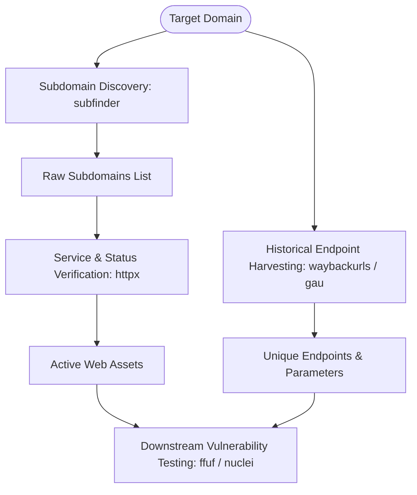

# Security Recon Toolkit


A collection of lightweight, modular Bash and Python scripts crafted to automate target reconnaissance, subdomain enumeration, and endpoint discovery. Built to streamline initial security assessments while maintaining optimal system performance and bandwidth efficiency.


---


## Features and Overview


- Sequential Recon Pipeline: Automated execution workflows that chain tools sequentially to prevent network congestion and resource spikes.
- Subdomain Discovery: Wrapper scripts for rapid passive and active subdomain gathering.
- Endpoint and Parameter Harvesting: Automated collection of historical URLs and entry points for deep parameter testing.
- Host and Service Verification: Fast IP resolving and HTTP status verification for target assets.


---


## Included Tools


| Script Name | Language | Purpose | Key Utilities Used |
|---|---|---|---|
| subdomain
_enum.sh | Bash | Automates target subdomain discovery and active host checking | subfinder, httpx |
| fetch_urls.sh | Bash | Collects archived endpoints and parameters sequentially | waybackurls, gau |
_resolver.sh | Bash | Performs batch DNS lookups and IP mapping for domain lists | nslookup, dig |
| param_cleaner.py | Python | Extracts and filters unique query parameters for testing | Python 3 (Native) |


---


## Usage Guide


### Prerequisites
Ensure standard security utilities and Python 3 are installed on your system:


```bash
sudo apt update && sudo apt install -y httpx subfinder waybackurls gau
Installation
Clone the repository and set executable permissions:
```

```bah


git clone [https://github.com/YOUR_USERNAME/security-recon-toolkit.git](https://github.com/YOUR_USERNAME/security-recon-toolkit.git)
cd security-recon-toolkit
chmod +x *.sh
Execution Example
Run subdomain discovery and verify active hosts for a target list:

```

```bash
./subdomain_enum.sh targets.txt output_dir
```
## Architecture and Design Principles
Resource-Conscious Execution: Uses controlled sequential loops to avoid excessive CPU and bandwidth usage during scanning.
Structured Workspace: Segregates output data into dedicated folders (1_environment, 2_stack, 3_access) for systematic analysis.
Modular Integration: Designed to pipe outputs directly into downstream testing tools such as ffuf, nuclei, or Burp Suite.


## Reconnaissance Pipeline Architecture



## Legal Disclaimer
These scripts are developed solely for educational purposes, authorized penetration testing, and legal bug bounty research. Unauthorized scanning without explicit permission is strictly prohibited.
